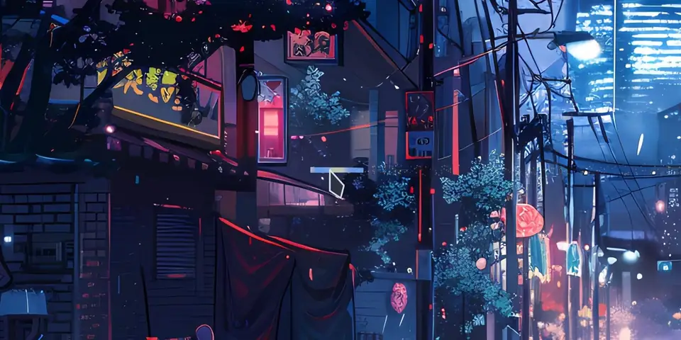

# Hyprtail
*Enjoy your cursor when you actually use it.*

[](https://github.com/noisethanks/hyprtail/actions/workflows/ci.yml)
[](LICENSE)
[]()

Performant shader-driven cursor trails for Hyprland.



## Features
- GPU accelerated
- Highly performant.
- Hot reloads.
- Supports all hyprcursor configurations.
- Hide from screen/window sharing.
- Window rules for visibilty.
- Animated warp transitions.
- Infinitely customizable with GLSL shaders.
- Particle spring animations.
- Builtins ranging from professional to flashy.


## Installation
```
hyprpm add https://github.com/noisethanks/hyprtail
hyprpm enable hyprtail
```

### Nix

A plugin loads only into the Hyprland it was built against, so make hyprtail
follow your Hyprland input:

```nix
inputs = {
  hyprland.url = "github:hyprwm/Hyprland";
  hyprtail = {
    url = "github:noisethanks/hyprtail";
    inputs.hyprland.follows = "hyprland";
  };
};
```

With Home Manager:

```nix
{ inputs, pkgs, ... }:
{
  wayland.windowManager.hyprland = {
    enable = true;
    plugins = [
      inputs.hyprtail.packages.${pkgs.stdenv.hostPlatform.system}.hyprtail
    ];
  };
}
```

Without Home Manager, load `lib/libhyprtail.so` from that package with
`hyprctl plugin load`.

`overlays.default` adds `hyprlandPlugins.hyprtail`, built against whatever
`hyprland` your pkgs has. hyprtail needs Hyprland 0.56 or newer.

## Configuring

```
hl.config({
    plugin = {
        hyprtail = {
            trail       = "builtin:comet", -- builtin:ink is the lighter choice; also embers, helix, jitter, mosaic, spring, vivid
            -- trail = "presets/ink.conf", -- or a path to config file relative to hyprtail root 
            warp         = "break", -- warping path calculation method, valid strings: break, line, curve
            emit_from    = "hotspot", -- normalized emission point, string, either `hotspot` or space separated floats between 0 an 1, e.g. `0.5 0.5` 
            emit_offset  = {0, 20}, -- additional offset for emission point, vec2 from -128 to 128
            screenshare  = "exclude", -- if trail is visible to screen share, valid strings: 'include','exclude'
            params       = "", -- advanced, refer to CONFIG.md
        },
    },
}) 

```
Point spacing (`min_spacing`, `max_spacing`), warp timing (`warp_speed`,
`warp_max_ms`, `warp_p1`, `warp_p2`) and a spring's length (`capacity`) belong
to each preset, as `source:` keys. A pointer trail keeps its points as long as
its layers' `fade_ms` draws them.
Override one through `params`, for example
`params = "source:max_spacing=4"`. See [docs/CONFIG.md](docs/CONFIG.md).

To disable the trail over specific clients, use this window rule:

```

if hl.plugin.hyprtail then
    hl.window_rule({
        match = { class = "^(mpv)$" },
        ["hyprtail:no_trail"] = true,
    })
end

```


builtins/presets:

<!-- presets:start -->
<!-- Generated by `make readme-presets` from each preset's description = and # variant: lines; do not edit. -->
- **`builtin:comet`**: Short tapered tail, ice blue flaring to amber, shedding sparks
  - Flares amber on lighter movement: `tail:speed_ref=1.5`
- **`builtin:embers`**: Rising embers that cool as they drift, electric crackle idle effect
  - Crackle stops after 8 s instead of redrawing until the pointer moves: `crackle:duration_ms=8000`
  - No crackle: `crackle:enabled=false`
- **`builtin:helix`**: Twin-strand helix with rungs
- **`builtin:ink`**: Calligraphy pen stroke that swells and thins with direction
  - Pulse at the cursor while it rests: `idle:enabled=true`
- **`builtin:jitter`**: Scattered dots around the trail (instanced, bounded offset)
- **`builtin:mosaic`**: Hexagonal cells that dissolve one by one along the path
- **`builtin:spring`**: A springy rope of points chasing the pointer
  - Livelier, longer rope: `source:head_damping_ratio=0.2 source:freq_hz=30`
- **`builtin:vivid`**: Cyan-to-magenta ribbon with a soft wide glow underneath
  - Wider glow, thicker core: `glow:width=40 core:width=6`
<!-- presets:end -->

`jitter`, `embers` and comet's `sparks` draw *(visible points) x (copies per point)* quads, so
`fade_ms`, how fast the pointer moves and the copy count set the GPU cost: the
most a single layer can draw is 64 copies x 4096 points.

## Notifications and diagnostics

- `hyprctl hyprtail` (add `-j` for JSON) shows the active preset, each
  layer's shader and current parameter values, per-monitor render stats,
  and the errors.log path — useful for checking that a config change
  actually took effect.


## Gallery

[!Presets](https://github.com/user-attachments/assets/49844821-3138-4413-a1af-df637a098f22)

## WIP
- Bezier curves for warp transitions.
- Benchmarking
- Catmul-Rom splines
- Cursor graphic shader source.
